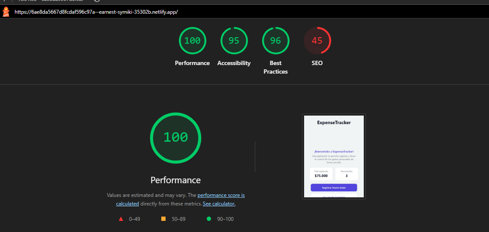

# ExpenseTracker PWA

Aplicación web progresiva para registrar y consultar gastos personales. Está construida con React y Vite.

## Desarrollo

Desde esta carpeta, instalá las dependencias y ejecutá el servidor local:

```bash
npm install
npm run dev
```

Para generar y previsualizar la versión de producción:

```bash
npm run build
npm run preview
```

## Auditoría Lighthouse (Mobile)

URL auditada: [ExpenseTracker en Netlify](https://6ae8da5667d8fcdaf596c97a--earnest-syrniki-35302b.netlify.app/)

Resultados: Performance 100, Accesibilidad 95, Best Practices 96 y SEO 45.


